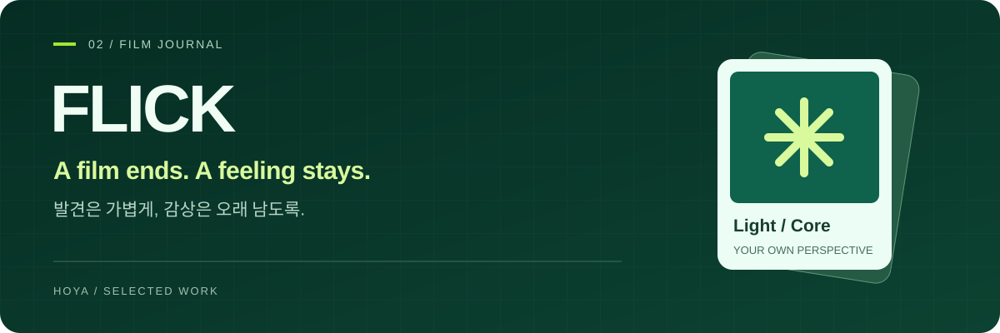
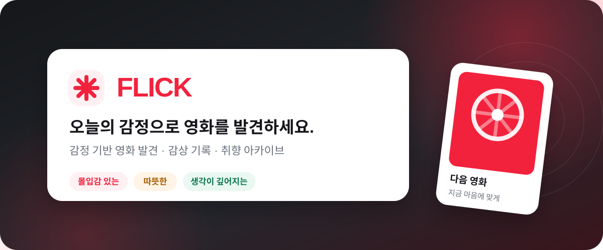
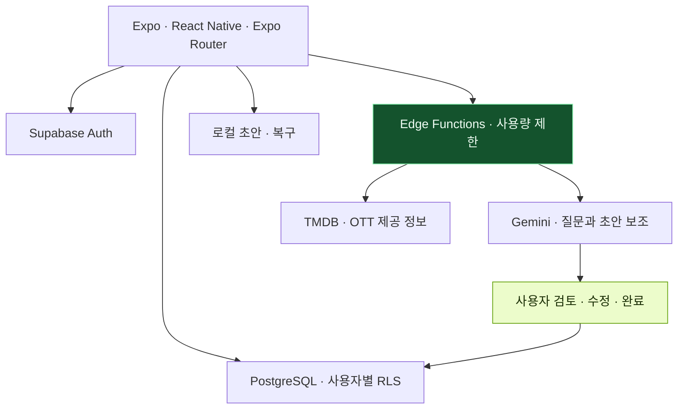

<p align="center">
  
</p>

<p align="center">
  <a href="https://flick-film-journal--beta.expo.app"></a>
  
  
  <a href="https://github.com/hoya0328/flick/actions/workflows/ci.yml"></a>
</p>

# FLICK

**그날의 감정으로 영화를 발견하고, 나만의 시선으로 기록하는 영화 저널입니다.**

[웹 베타 사용해 보기](https://flick-film-journal--beta.expo.app) · [화면 구성](docs/SCREEN_STRUCTURE.md) · [아키텍처](docs/ARCHITECTURE.md) · [로드맵](docs/ROADMAP.md)

## 프로젝트를 시작한 이유

좋은 영화를 보고도 시간이 지나면 줄거리보다 그날의 기분이 먼저 떠오르곤 합니다. 별점과 한 줄만 남기기에는 아쉽지만, 매번 정돈된 리뷰를 쓰는 일은 부담스러웠습니다.

FLICK은 이 사이의 간격을 줄이는 서비스입니다. 지금의 감정에 맞는 영화를 발견하고, 짧게 남기거나 깊게 생각할 수 있는 기록 방식을 선택하게 했습니다. 쌓인 기록은 캘린더와 취향 리포트로 돌아와 다음 영화를 고르는 단서가 됩니다.

**더 많은 리뷰를 쓰게 하는 것보다, 내 감상을 무리 없이 남기고 다시 꺼내보게 하는 것**을 중요하게 생각했습니다.

## 브랜드와 사용 경험

<p align="center">
  
  <br />
  <sub>초록색 포트폴리오 테마와 함께, FLICK 고유의 코랄 컬러와 영화 카드 비주얼을 유지했습니다. 위 이미지는 브랜드 소개 아트입니다.</sub>
</p>

## 발견부터 재발견까지

| 흐름 | 사용자가 할 수 있는 일 |
| :--- | :--- |
| **발견** | 감정 키워드를 고르고, 영화를 검색하거나 한국 OTT 제공 정보를 확인합니다. |
| **감상 준비** | 보고 싶은 영화를 저장해 다음 감상을 준비합니다. |
| **기록** | Light 또는 Core를 선택해 감상을 남깁니다. 작성 중인 초안은 자동 저장됩니다. |
| **회고** | 캘린더와 취향 리포트에서 그동안의 감상과 선호를 살펴봅니다. |
| **재발견** | 공개 기록·컬렉션·큐레이션에서 다른 관점을 만나고 다음 영화를 찾습니다. |

공개 피드에는 공감·댓글·저장 기능을 더했고, 가볍게 방문할 수 있는 이모지 영화 퀴즈도 제공합니다. 다만 서비스의 중심은 어디까지나 자신의 기록을 쌓고 돌아보는 경험입니다.

## 상황에 맞게 선택하는 두 가지 기록

| | Light | Core |
| :--- | :--- | :--- |
| **사용하는 순간** | 짧게라도 감상을 남기고 싶을 때 | 인상 깊었던 이유를 더 정리하고 싶을 때 |
| **입력 방식** | 질문과 느낌 태그 중심으로 빠르게 기록합니다. | 앞선 답변에 따라 이어지는 질문에 답합니다. |
| **AI의 역할** | AI 없이도 기록할 수 있습니다. | 동의한 경우 질문과 초안 정리를 보조합니다. |
| **완성 방식** | 간결한 감상 기록으로 마무리합니다. | 초안을 직접 읽고 수정해 자신의 글로 완성합니다. |

AI가 결과를 바로 게시하지 않습니다. 사용자가 검토하고 완료해야 기록이 확정되며, 공개 여부도 별도로 선택합니다.

## 설계에서 중요하게 다룬 점

### 1. 글쓰기 부담을 기능으로 나눴습니다

처음부터 긴 텍스트 입력을 요구하는 대신, 모드 선택과 질문·태그를 통해 시작할 수 있게 했습니다. 작성 도중 화면을 벗어나더라도 이어갈 수 있도록 초안을 로컬에 보관합니다. AI나 영화 API의 일시적인 오류가 기록 자체를 막지 않도록 경계도 나눴습니다.

### 2. 공개 기능보다 개인 기록의 소유권을 먼저 정했습니다

새 기록은 `나만 보기`로 시작합니다. 공개 링크는 편집 화면과 분리된 읽기 전용 상세로 연결하고, 사용자별 읽기·쓰기 권한은 Supabase RLS에서 다시 확인합니다. 화면에서 버튼을 숨기는 것만으로 접근 제어를 대신하지 않습니다.

### 3. AI 호출과 외부 키를 서버로 모았습니다

영화 데이터와 AI 요청은 서버 함수를 거칩니다. 공급자 키와 프롬프트·호출 한도를 앱 번들에 두지 않으며, AI가 만든 초안과 사용자가 확정한 기록을 구분합니다. 호출 실패와 비용을 제품 흐름 안에서 다룰 수 있도록 구성했습니다.

## 시스템 구조



| 영역 | 기술과 선택 배경 |
| :--- | :--- |
| 앱·웹 | Expo · React Native · Expo Router로 웹·iOS·Android의 공통 흐름을 관리합니다. |
| 타입·검증 | TypeScript strict와 Vitest로 입력·상태·권한 관련 계약을 검증합니다. |
| 인증·데이터 | Supabase Auth · PostgreSQL · RLS로 사용자별 기록을 분리합니다. |
| 외부 연동 | Edge Functions에서 TMDB 조회와 선택적 Gemini 보조를 처리합니다. |
| 웹 배포 | EAS Hosting의 기존 beta 환경을 사용합니다. |
| CI | 타입 검사·린트·테스트·웹 정적 빌드를 검사합니다. |

## 구현 상태와 다음 과제

| 구분 | 현재 범위 |
| :--- | :--- |
| **구현·웹 베타** | 감정 기반 발견, 영화 검색·상세, 관심 목록, Light/Core 기록, AI 보조, 자동 초안 저장 |
| **구현·웹 베타** | 캘린더·취향 리포트, 공개 기록·댓글·컬렉션·큐레이션, 영화 퀴즈 |
| **최종 통합 검증 예정** | 서로 다른 계정의 접근 경계, 계정 삭제 시 연관 데이터 정리, 보안 점검 후속 항목 |
| **후속 배포** | iOS TestFlight와 Android 빌드, 스토어 자산과 정식 출시 안내 정비 |

웹 베타 공개와 정식 출시 준비 완료는 구분합니다. 의존성 보안 점검의 잔여 항목과 네이티브 출시 조건은 [릴리스 체크리스트](docs/RELEASE_CHECKLIST.md)와 [인수인계](docs/HANDOFF.md)에 기록했습니다.

<details>
<summary><strong>로컬 실행과 검증</strong></summary>

CI와 같은 Node.js 22 환경을 권장합니다.

```bash
git clone https://github.com/hoya0328/flick.git
cd flick
npm install
cp .env.example .env.local
npm run web
```

Windows PowerShell에서는 환경 파일 복사에 `Copy-Item .env.example .env.local`을 사용할 수 있습니다. 인증·영화 조회 등 외부 연동을 직접 실행하려면 [Supabase 설정](docs/SUPABASE_SETUP.md)과 환경 변수 예시를 확인해 주세요. 서버 전용 키를 공개 클라이언트 변수에 넣지 않습니다.

```bash
npm run check
npm run build:web
```

</details>

## 더 자세한 문서

| 궁금한 내용 | 문서 |
| :--- | :--- |
| 문제 정의와 제품 범위 | [프로젝트 맥락](docs/PROJECT_CONTEXT.md) · [화면 구조](docs/SCREEN_STRUCTURE.md) |
| 데이터 모델과 접근 권한 | [아키텍처](docs/ARCHITECTURE.md) · [설계 결정](docs/DECISIONS.md) |
| 외부 데이터와 운영 비용 | [영화 카탈로그](docs/TMDB_CATALOG.md) · [비용 기준](docs/COSTS.md) |
| 다음 개발과 검증 | [로드맵](docs/ROADMAP.md) · [릴리스 체크리스트](docs/RELEASE_CHECKLIST.md) |

### 데이터 출처

영화 정보와 이미지는 [TMDB](https://www.themoviedb.org/)를 사용합니다. OTT 정보는 TMDB가 제공하는 JustWatch 기반 데이터를 표시하며, 실제 제공 여부는 해당 서비스에서 확인할 수 있습니다.

> This product uses the TMDB API but is not endorsed or certified by TMDB.

---

[기여 안내](CONTRIBUTING.md) · [보안 제보](SECURITY.md) · [권리·출처 고지](NOTICE.md) · [HOYA의 다른 프로젝트](https://github.com/hoya0328)
